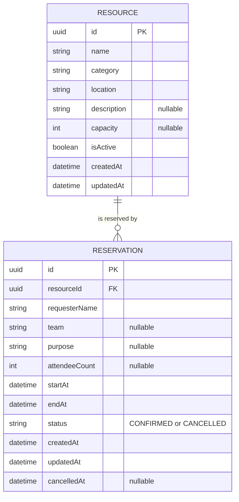

# Software Requirements Specification (SRS)

## Resource Reservation Management System (RRMS)

| Document field | Value |
|---|---|
| Project | Resource Reservation Management System (RRMS) |
| Assessment | Software Engineering Internship — PrimeWave Lab (Pvt) Ltd |
| Document ID | RRMS-SRS-001 |
| Version | 1.0 — Proposed implementation baseline |
| Date | 12 October 2026 |
| Status | Proposed baseline for review; not a claim of completed implementation |
| Submission deadline | 15 October 2026, 11:59 PM, Sri Lanka Time (UTC+05:30) |
| Intended repository path | `docs/SRS.md` |

> **Source and interpretation notice**
>
> The provided **PrimeWave Lab Software Engineering Internship Technical Assessment** defines the business scenario, required technical stack, submission materials, and evaluation areas. **It does not prescribe individual features, user roles, data tables, or reservation policies.** Every detailed requirement and business rule in this SRS is an **explicit design proposal derived from that scenario**, not a requirement quoted from the company. These choices are intended to produce a focused, demonstrable application within the assessment timeline. See §2 and §17 for traceability.

---

## 1. Introduction

### 1.1 Purpose

This SRS defines what the proposed RRMS must do, how its core reservation decisions must behave, the boundaries of the initial release, and what counts as successful implementation. It is intended for the developer, reviewers, testers, and future maintainers.

### 1.2 Product vision

Create a small, centralized web application that lets a trusted resource coordinator manage a shared-resource catalog, view availability, create or modify reservations, and prevent conflicting allocations. The system replaces ambiguous manual schedules with one consistent record of resource usage.

### 1.3 Definitions

| Term | Meaning in this system |
|---|---|
| Resource | An individually bookable physical facility or item, such as a meeting room, training room, or a specific projector. |
| Reservation | A confirmed allocation of **one** resource to a named requester for a precise start/end interval. |
| Availability | Whether a resource is eligible for reservation over the **entire** requested time interval. |
| Overlap | Two time ranges share a positive amount of time; touching endpoints alone do not overlap. |
| Coordinator | The trusted person operating the application on behalf of requesters; not an authenticated role in MVP. |
| Requester | The employee/team representative for whom a coordinator creates a booking. |
| Active resource | A resource that may receive new reservations. |
| Confirmed reservation | A reservation that occupies its resource's interval unless cancelled. |
| Cancelled reservation | Historical reservation record that no longer consumes availability. |
| P0 / P1 / P2 | Release priority: mandatory MVP / valuable if time permits / explicitly deferred. |
| MVP | Minimum viable product for this assessment, **not** a production-grade multi-user platform. |

### 1.4 Source document

The source is the five-page assessment PDF provided with the assignment. Its relevant sections are: **§2 Business Scenario; §3 Your Assignment; §4 Technical Expectations; §5 Development Approach; §6 Scope; §7 Submission Requirements; §8 Evaluation; §9 Submission Instructions**.

---

## 2. Problem analysis and engineering rationale

### 2.1 Observed business problem (from assessment)

The hypothetical organization manages shared resources through informal communication and manual records. As resource demand increases, staff face scheduling uncertainty, overlap, and difficulty knowing availability. The organization needs a practical centralized solution and expects everyday operational reliability.

### 2.2 Why a simple CRUD application is insufficient

A form that stores bookings without enforcing time-based business invariants does not solve the company's main problem. A credible solution must answer:

1. **Can the resource be booked for the entire requested interval?**
2. **Is it active and suitable for the intended reservation?**
3. **What happens if an existing reservation is edited or cancelled?**
4. **What happens when two requests arrive almost simultaneously?**
5. **Can historical reservations be recovered without treating cancelled bookings as occupied?**
6. **Can an operator understand why a reservation was rejected and correct it?**

### 2.3 Business objectives

| ID | Objective | Demonstrable success condition |
|---|---|---|
| OBJ-01 | Single source of truth | Resources and reservations load from PostgreSQL after an application restart. |
| OBJ-02 | Prevent double booking | No two **confirmed** reservations for the same resource have overlapping intervals, including under concurrent requests. |
| OBJ-03 | Make availability understandable | Coordinator can see time-based bookings and check an intended slot before creating a reservation. |
| OBJ-04 | Support practical changes | Confirmed reservations may be rescheduled or cancelled while preserving business rules and history. |
| OBJ-05 | Support resource lifecycle | Resources can be created, edited, and deactivated without losing past reservation records. |
| OBJ-06 | Be easy to assess | A reviewer can run the project locally, follow the core workflow, review the ER diagram, and reproduce the tests. |

### 2.4 Working assumptions — NOT stated by PrimeWave Lab

**A-01.** The MVP serves **one organization**, rather than multiple tenants.

**A-02.** Each resource record represents one exclusively bookable unit. If a company owns three projectors, it can register them separately (e.g., Projector 01–03). Pooled inventory and quantity-based reservations are excluded.

**A-03.** The application is operated by a **trusted internal coordinator**; the requester is recorded as data, not signed in. Authentication is deferred and the MVP must **not** be promoted as a publicly writable production system.

**A-04.** A reservation is **immediately confirmed** when accepted. There is no approval queue or waitlist in MVP.

**A-05.** The default UI timezone is **Asia/Colombo**. Instants are stored consistently using timezone-aware timestamps; a later release could support multiple regions.

**A-06.** The organization has **not** supplied opening hours, lead-time rules, maximum booking durations, holiday calendars, or approval policies. The application must **not silently invent** them.

**A-07.** Reservations involve one resource and one continuous interval, not recurring series or composite equipment bundles.

**A-08.** Resource capacity (where meaningful) is descriptive, with optional attendee-count validation; the MVP does not support seat-by-seat allocation.

**A-09.** The assessment requires local execution and persistent storage; public deployment is optional and not a deliverable specified by the PDF.

**A-10.** Time intervals may cross midnight; no operating-hours restrictions have been given. Date-filtered views must still show bookings that overlap the selected day, even if the booking started the previous day.

---

## 3. Stakeholders, actors, and user journeys

### 3.1 Actors

| Actor | Responsibility | MVP access model |
|---|---|---|
| Resource Coordinator | Maintain resources, check availability, create/update/cancel bookings, resolve conflicts. | One trusted operator using the web application; no login. |
| Requester (employee/team) | Needs a resource, date, time, and booking confirmation. | Not an application account; name/team recorded on a reservation. |
| Assessment Reviewer | Evaluates functional behavior, code, decisions, diagrams, and documentation. | Runs the application locally using README instructions. |

> Future user roles (admin, employee self-service, approver) are valid product extensions, **not part of the committed MVP**.

### 3.2 User stories (P0)

- **US-01** As a coordinator, I want to register a resource so that it appears in the central catalog.
- **US-02** As a coordinator, I want to update a resource or deactivate it so that the catalog reflects operational reality.
- **US-03** As a coordinator, I want to inspect existing reservations by resource/date so that I can recommend an available slot.
- **US-04** As a coordinator, I want to create a reservation for a named requester so that the booking is recorded reliably.
- **US-05** As a coordinator, I want the system to reject a conflicting time range and explain the conflict so that double booking cannot occur.
- **US-06** As a coordinator, I want to move a future reservation so that changed plans do not require deleting history.
- **US-07** As a coordinator, I want to cancel a future reservation so that its slot becomes available again.
- **US-08** As a coordinator, I want to see existing and cancelled reservations so that I understand booking history.

### 3.3 Principal workflow

1. Open **Resources** and identify a suitable active resource.
2. Open **Reservations / Availability** and select the desired date/time interval.
3. The application shows relevant existing bookings and indicates whether the full interval appears available.
4. Enter requester name, optional team/purpose, and the requested interval.
5. Submit; the server validates input, time, active status, and resource existence.
6. The database enforces the **final no-overlap invariant** as the reservation is written.
7. On success, show booking details and updated reservation views.
8. On conflict, show a non-technical explanation; preserve the form inputs and allow another slot to be chosen.
9. For a later change, reschedule (with revalidation) or cancel (while retaining the record).

---

## 4. Scope and feature prioritization

### 4.1 P0 — committed MVP

| Module | Features included | Rationale |
|---|---|---|
| Resource catalog | Create, list, view, edit, activate/deactivate; simple filtering. | Central resource organization. |
| Reservation core | Create, list, detail view, reschedule a **future** confirmed booking, cancel a **future** confirmed booking. | Complete everyday booking lifecycle. |
| Availability | Show a selected resource's bookings; validate a candidate interval; exclude cancelled bookings from occupancy. | Direct solution to scheduling confusion. |
| Booking integrity | Validate on server; defend against **concurrent** overlapping submissions at database level. | Most important reliability differentiator. |
| History | Preserve cancelled/past booking records; show clear booking state. | Traceability and credibility. |
| Basic UX | Responsive forms, loading/empty/error/success states, clear navigation and conflict messages. | Reviewer can use the app without instructions. |
| Quality evidence | Focused automated tests, README, migration, seed data, ER diagram, demo video. | Meets assessment review and submission expectations. |

### 4.2 P1 — implement only after P0 is stable

| ID | Feature | Reason |
|---|---|---|
| P1-01 | Simple dashboard metrics (total/active resources, upcoming reservations). | Convenient summary, but less important than booking correctness. |
| P1-02 | Resource maintenance/blackout windows. | Models temporary unavailability; requires consistent concurrency rules across blackout and booking writes. |
| P1-03 | Advanced filters and calendar/timeline visualization. | Improves usability but not fundamental correctness. |
| P1-04 | Friendly alternative time suggestions. | Reduces user friction but adds search/optimization logic. |

### 4.3 P2 — deliberately out of scope

Authentication, employee self-service, role-based access, multi-tenant organizations, email/SMS notifications, external calendar integrations, approval workflows, recurring bookings, billing, multi-resource transactions, pooled inventory, waitlists, check-in/out tracking, analytics, websockets, and cloud deployment are **not committed** for this assessment. Do not present these as implemented.

---

## 5. Functional requirements

Every P0 requirement is mandatory for the proposed implementation baseline; each includes testable behavior. References to a 'server' mean trusted Next.js server-side logic, not client-side validation alone.

### 5.1 Resource management

| ID | Priority | Requirement and expected behavior |
|---|---|---|
| FR-001 | P0 | Coordinator can create a resource with required `name`, `category`, `location`, and `isActive = true` by default. |
| FR-002 | P0 | Resource category supports at least `ROOM`, `EQUIPMENT`, `OTHER`; it does **not** change exclusive-booking semantics. |
| FR-003 | P0 | Coordinator can list resources with clear name, category, location, status, and optional capacity. |
| FR-004 | P0 | Coordinator can view and edit resource properties (name, category, location, description, optional capacity). |
| FR-005 | P0 | Coordinator can activate/deactivate a resource; an inactive resource cannot receive new reservations. |
| FR-006 | P0 | Deactivation must be **rejected while future or currently ongoing confirmed reservations exist**; UI explains that affected bookings must first be cancelled or rescheduled. Historical records remain. |
| FR-007 | P0 | Resource creation/edit rejects blank names/locations, invalid capacity, and duplicate normalized **name + location** pairs. |
| FR-008 | P0 | Resource details and historical reservations remain available when the resource is inactive; hard deletion is not exposed in MVP. |
| FR-009 | P0 | Resource list can be filtered at least by category and active/inactive status, or provide an equivalent low-complexity discovery control. |

### 5.2 Reservation management

| ID | Priority | Requirement and expected behavior |
|---|---|---|
| FR-010 | P0 | Create a reservation for exactly one existing **active** resource. |
| FR-011 | P0 | Required reservation data: resource, nonblank requester name, start timestamp, and end timestamp. Team and purpose are optional. |
| FR-012 | P0 | A successful create receives an ID, `CONFIRMED` status, creation timestamp, and persisted start/end timestamps. |
| FR-013 | P0 | Reservation list displays resource, requester, start/end, status and whether the booking is upcoming/ongoing/past. |
| FR-014 | P0 | Coordinator can open a reservation and view all its stored details. |
| FR-015 | P0 | Coordinator can reschedule a **future** `CONFIRMED` reservation, including changing the resource if needed; validation and conflict prevention run again. |
| FR-016 | P0 | A reschedule retains the same reservation ID and records `updatedAt`; if it fails, the original booking remains unchanged. |
| FR-017 | P0 | Coordinator can cancel a **future** `CONFIRMED` reservation after explicit confirmation; status becomes `CANCELLED`, `cancelledAt` is recorded, and the slot is freed. |
| FR-018 | P0 | A cancelled reservation cannot be edited, rescheduled, or cancelled again; it remains readable. |
| FR-019 | P0 | A reservation with a start time already reached cannot be rescheduled or cancelled in MVP; show a clear message instead of silently modifying operational history. |
| FR-020 | P0 | Reservations can be filtered by date range, resource, and stored status; all records remain queryable. |
| FR-021 | P0 | No client can create or modify reservations by trusting a client-provided status, resource active flag, or availability result. The server derives/enforces these. |

### 5.3 Availability and conflicts

| ID | Priority | Requirement and expected behavior |
|---|---|---|
| FR-022 | P0 | For a selected active resource and proposed `[start, end)` interval, availability check indicates whether the **entire interval** is free of confirmed reservations. |
| FR-023 | P0 | The UI shows existing confirmed bookings relevant to the selected resource/day or range. |
| FR-024 | P0 | Creating or rescheduling an overlapping confirmed reservation is rejected with a clear conflict message and no partial data update. |
| FR-025 | P0 | A cancelled reservation never blocks a new reservation for the same time. |
| FR-026 | P0 | Two different resources may be reserved for exactly the same time interval. |
| FR-027 | P0 | Adjacent reservations are allowed when the earlier reservation's end equals the later one's start. |
| FR-028 | P0 | Reservation creation/rescheduling must re-check eligibility during the write; UI preview **does not guarantee** later availability. |
| FR-029 | P0 | Simultaneous writes cannot leave overlapping confirmed reservations in the database. Enforce this with a PostgreSQL-level invariant, not only a `SELECT`-then-`INSERT` check. |
| FR-030 | P0 | Creating/rescheduling a booking and deactivating/changing capacity of the same resource must be **coordinated atomically**, so their interleaving cannot produce an inactive resource with future confirmed bookings or a capacity violation. |
| FR-031 | P0 | A date-filtered booking list must include reservations **overlapping** the selected day, including reservations that began on an earlier date and end on the selected date. |

### 5.4 User interface and operational feedback

| ID | Priority | Requirement and expected behavior |
|---|---|---|
| FR-032 | P0 | Show navigation to Resource List, Reservation List, and New Reservation / Availability views. |
| FR-033 | P0 | Forms show required fields, inline validation, understandable errors, and preserve user-entered values after failed submissions. |
| FR-034 | P0 | New/cancelled/rescheduled bookings produce confirmation feedback and refreshed persisted results. |
| FR-035 | P0 | Empty states explicitly distinguish 'no resources exist', 'no reservations', and 'no matching filter results'. |
| FR-036 | P0 | UI supports desktop and mobile viewport widths without hiding critical fields or actions. |
| FR-037 | P0 | Time labels explicitly state the UI timezone (e.g. `Asia/Colombo / Sri Lanka Time`). |

### 5.5 P1 enhancement requirements (NOT release blockers)

| ID | Priority | Requirement |
|---|---|---|
| FR-038 | P1 | Display a small dashboard with counts computed from the database, not hardcoded values. |
| FR-039 | P1 | Allow a coordinator to block a resource for maintenance/unavailability with an interval and reason. |
| FR-040 | P1 | If blackouts are introduced, booking and blackout writes must use **one consistent no-overlap mechanism**; do not rely on independent checks in separate tables. |
| FR-041 | P1 | Display a resource's occupancy in an optional calendar/timeline view. |
| FR-042 | P1 | Suggest one or more valid alternative start times after a conflict. |

---

## 6. Normative business rules

These rules are the product's highest-value decision logic. Test IDs in §12 trace to these rules.

| ID | Business rule | Result if violated |
|---|---|---|
| BR-001 | `startAt` and `endAt` must be valid instants and `startAt < endAt`. | Reject invalid booking with a field-specific error. |
| BR-002 | At the time of creation, `startAt` must be in the future (relative to trusted server time). | Reject past/immediate elapsed starts. |
| BR-003 | An allocation must reference an existing resource. | Reject invalid resource ID. |
| BR-004 | Only active resources are eligible for new or rescheduled reservations. | Reject with inactive-resource explanation. |
| BR-005 | **For one resource, intervals of any two `CONFIRMED` reservations must not overlap.** | Reject write atomically; no double booking. |
| BR-006 | Define reservation intervals as **half-open** `[startAt, endAt)`. Thus `10:00–11:00` and `11:00–12:00` do not overlap. | Permit adjacent bookings; reject intervals sharing positive time. |
| BR-007 | Overlap test is `newStart < existingEnd AND newEnd > existingStart` for same resource, confirmed status. | Indicate conflict; do not save. |
| BR-008 | `CANCELLED` reservations remain stored but release their occupied intervals. | Ignore them for availability; preserve history. |
| BR-009 | When rescheduling, exclude the **same reservation's existing record** from logical conflict comparison; database rechecks the resulting interval. | Do not self-conflict; still reject collisions with other bookings. |
| BR-010 | An unsuccessful create or reschedule must not partially change data. | Atomic failure; preserve previous state. |
| BR-011 | A reservation can transition `CONFIRMED -> CANCELLED` once. No reactivation in MVP. | Reject invalid transitions. |
| BR-012 | Only future confirmed reservations can be rescheduled/cancelled. | Preserve historical/ongoing records. |
| BR-013 | Resource deactivation is disallowed if it has any ongoing or future confirmed reservations. | Request operator to resolve commitments first. |
| BR-014 | Inactive resources and cancelled reservations are still visible in history; no hard-delete workflow. | Retain auditability of bookings. |
| BR-015 | Resource identity is unique by trimmed, case-insensitive **name + location**; category alone does not define identity. | Reject duplicates; allow similarly named rooms at different locations. |
| BR-016 | `capacity`, when supplied, is a positive whole number; optional `attendeeCount`, when supplied, must be positive and not exceed resource capacity. | Reject invalid occupancy data. |
| BR-017 | All relevant rules are enforced server-side; frontend validation is additional feedback only. | Reject crafted/invalid HTTP or action payloads. |
| BR-018 | The database is the final authority on concurrent reservation conflicts. | Exactly one overlapping concurrent request may commit, not both. |
| BR-019 | Read-only availability indicators are snapshots. Creation or rescheduling must be checked again on submission. | Return a conflict if the slot was taken since preview. |
| BR-020 | All timestamps represent absolute instants stored consistently; UI converts to the documented display timezone. | Avoid accidental shifts in displayed/reserved time. |
| BR-021 | No unspecified business hours, holidays, recurring bookings, buffer times, maximum booking duration, or approval requirements are enforced. | Prevent undocumented restrictions. |
| BR-022 | If a capacity change would make any future/ongoing reservation's supplied attendee count exceed the new capacity, block that edit until conflicts are resolved. | Preserve existing booking validity. |
| BR-023 | A booking may cross midnight; date filtering uses **interval overlap** with the selected local-calendar day, not only `startAt` matching that date. | Do not hide overnight resource usage. |
| BR-024 | Resource deactivation/capacity edits and reservation creation/rescheduling must serialize their relevant checks and writes for the same resource. | Prevent deactivation/booking or capacity/booking race conditions. |

### 6.1 Precise overlap examples

Existing confirmed reservation: **Meeting Room A, 14 October, 10:00–11:00**.

| Proposed interval | Decision | Explanation |
|---|---|---|
| 09:00–10:00 | Allow | Adjacent on the left. |
| 10:00–11:00 | Reject | Exact overlap. |
| 10:30–11:30 | Reject | Partial overlap. |
| 09:30–10:30 | Reject | Partial overlap. |
| 09:00–12:00 | Reject | Contains an existing reservation. |
| 10:15–10:45 | Reject | Wholly inside an existing reservation. |
| 11:00–12:00 | Allow | Adjacent on the right. |
| 10:00–11:00, different resource | Allow | Resource-specific exclusivity. |
| 10:00–11:00, same resource, after original is cancelled | Allow | Cancelled booking no longer occupies the time. |

### 6.2 Concurrency: the critical non-obvious case

Consider **two coordinators or two browser tabs** submitting the same free interval simultaneously:

1. Request A checks availability: free.
2. Request B checks availability: free.
3. A and B attempt to insert a confirmed reservation.
4. **Required outcome:** one insert succeeds; the other fails with a booking-conflict response. Both must never succeed.

A pre-insert `SELECT` alone has a race condition. In PostgreSQL, a strong implementation option is an **exclusion constraint** on the resource identifier and a timezone-aware reservation range, applying only to confirmed bookings. Use a migration for the constraint; Prisma's schema file alone may not represent it.

Illustrative PostgreSQL design (**adapt identifiers and enum mapping to actual migrations**):

```sql
CREATE EXTENSION IF NOT EXISTS btree_gist;

ALTER TABLE "Reservation"
ADD CONSTRAINT reservation_no_confirmed_overlap
EXCLUDE USING gist (
  "resourceId" WITH =,
  tstzrange("startAt", "endAt", '[)') WITH &&
)
WHERE ("status" = 'CONFIRMED');
```

Ensure `startAt` and `endAt` are stored using timezone-aware PostgreSQL types (`timestamptz`, e.g. Prisma `@db.Timestamptz(3)`). Also enforce `endAt > startAt` with a database `CHECK` constraint if supported in the selected migration approach. Translate constraint-violation errors into a clear **409 Conflict**-equivalent UI message, not a generic 500 error. Concurrency integrity matters **even if the interface is nominally single-coordinator**, because multiple tabs, retries, or later multi-user use may occur.

**Second concurrency invariant — resource state changes:** the reservation exclusion constraint alone does **not** prevent the race between booking a resource and deactivating it (or reducing its capacity). Use a single database transaction and acquire a row-level lock on the affected `Resource` record (for example `SELECT ... FOR UPDATE`) before checking its active state/capacity and writing the reservation; deactivation/capacity-update transactions must acquire the **same resource lock** before checking current/future reservations and updating the resource. For rescheduling between resources, acquire locks in a deterministic ID order to reduce deadlock risk. Re-check the business rules inside the lock. This is an implementation approach to satisfy BR-024; equivalent safe transactions are acceptable.

**Important for P1 blackouts:** exclusion constraints on separate `Reservation` and `Blackout` tables will *not* automatically prevent booking-vs-blackout overlaps. If implementing FR-039, use a shared allocation timeline/table or an equivalently robust transactional locking strategy covering **both** allocation types, and extend concurrency tests. Otherwise **do not claim** blackout safety.

### 6.3 Lifecycle state versus time-derived view

A reservation's **stored** state is either `CONFIRMED` or `CANCELLED`. For presentation, a confirmed reservation may be labelled:

- **Upcoming:** `now < startAt`.
- **In progress:** `startAt <= now < endAt`.
- **Past:** `endAt <= now`.

These are **derived labels**, not additional mutable database statuses. This avoids a background job solely to mark past bookings as completed. `CANCELLED` takes display precedence over time-derived labels.

### 6.4 Resource deactivation example

Room A has a confirmed meeting tomorrow. Marking it inactive without addressing that booking would silently invalidate a promise. For MVP, the **deactivation action fails with an actionable message** until the future booking is cancelled or rescheduled. Past bookings do not block deactivation; activation can be restored later. This is an explicit project policy, not a rule provided in the assignment.

---

## 7. Data specification

### 7.1 Proposed conceptual data model (P0)



The final assessment submission must include a **shareable ER diagram link**. The Mermaid diagram in this file is a developer-readable conceptual design; also export or publish a reviewer-accessible diagram if needed by the submission form.

### 7.2 Resource entity

| Field | Type / constraint | Why it exists |
|---|---|---|
| `id` | UUID, primary key | Stable resource identity. |
| `name` | Text, required, trimmed | Human-readable resource name. |
| `category` | Enum: ROOM/EQUIPMENT/OTHER | Resource discovery and description. |
| `location` | Text, required, trimmed | Distinguishes same-named assets in different places. |
| `description` | Optional text | Useful usage notes. |
| `capacity` | Optional positive integer | For resources with meaningful person capacity. |
| `isActive` | Boolean, defaults `true` | Eligibility for new bookings. |
| `createdAt`, `updatedAt` | Timezone-aware timestamps | Traceability. |

A functional case-insensitive uniqueness check on `(normalizedName, normalizedLocation)` should be backed by a database unique index or normalized unique columns; frontend-only uniqueness checking is insufficient under concurrent creation.

### 7.3 Reservation entity

| Field | Type / constraint | Why it exists |
|---|---|---|
| `id` | UUID, primary key | Stable booking reference. |
| `resourceId` | Required FK → Resource | Booked resource. |
| `requesterName` | Nonblank trimmed text | Human requesting the allocation. |
| `team` | Optional text | Context for internal use. |
| `purpose` | Optional text | Booking context. |
| `attendeeCount` | Optional positive integer | Optional room capacity check. |
| `startAt`, `endAt` | `timestamptz`; start before end | Exact occupancy interval. |
| `status` | `CONFIRMED` / `CANCELLED` | Determines occupancy. |
| `createdAt`, `updatedAt` | Timezone-aware timestamps | History and support. |
| `cancelledAt` | Nullable timezone-aware timestamp | Cancellation audit information. |

### 7.4 Data invariants and deletion policy

- Foreign-key integrity prevents reservations from referring to nonexistent resources.
- Confirmed bookings for the same resource cannot overlap; this is a **database invariant**.
- `startAt < endAt` is validated server-side and preferably with a database check constraint.
- A cancelled reservation remains in the database with its original times and resource reference.
- Do **not** cascade-delete reservations from the UI. No physical resource delete is required in MVP.
- Seed data must be clearly labelled as sample data and should demonstrate free, booked, cancelled, active, and inactive cases.

### 7.5 If the P1 maintenance feature is added

Model blocked intervals so that the same resource occupancy invariant covers **confirmed reservations and active maintenance blocks**. Conceptually:

```text
Resource (1) -- (many) ResourceAllocation
ResourceAllocation: resourceId, startAt, endAt, kind=RESERVATION|BLACKOUT,
                    active, reservationId?, reason?
```

This is **future design guidance**, not an extra P0 table that must be implemented now.

---

## 8. UI / screen requirements

### 8.1 Minimum navigable screens

| Screen | Important elements | P0 interaction |
|---|---|---|
| Resources | Name/category/location/status, add/edit controls, filters. | Create and manage catalog. |
| Resource details | Resource attributes, eligibility, upcoming bookings. | Understand resource's schedule and edit eligibility. |
| Reservations | Date/resource/status filters; booking table/list; booking details. | Browse and manage history. |
| New/Edit reservation | Resource, requester, start/end, availability feedback, submit/cancel. | Book or reschedule safely. |

A dashboard may serve as the homepage but is **P1**. A dedicated calendar view is also P1; a clear booking list suffices for P0.

### 8.2 Interaction design details

- Dates and times must be legible and include their timezone.
- The **submit action must be disabled during submission** to reduce accidental duplicate clicks; the server/database still provides the real safety guarantee.
- On a conflict, retain form values and show a message such as: *“Meeting Room A is already reserved for part of that period. Choose another time.”*
- On cancellation, use a confirmation dialog naming the resource and time; do not make deletion-looking actions irreversible by accident.
- Clearly distinguish resource status (**Active / Inactive**) from reservation status (**Confirmed / Cancelled**) and time-derived status (**Upcoming / In progress / Past**).
- Show empty/loading/error states; do not show fake hardcoded ‘availability’ once the database is connected.
- Keyboard-accessible labels/buttons, usable contrast, and responsive layouts are expected.

---

## 9. Validation and failure-handling requirements

| Situation | Required behavior | Suggested web-equivalent status |
|---|---|---|
| Missing requester name or required fields | Explain which field is required; save nothing. | 400 / field validation |
| Start is after/equal to end | Explain valid time ordering; save nothing. | 400 |
| Start is in the past | Explain future booking rule; save nothing. | 400 |
| Resource ID does not exist | Show 'Resource not found'. | 404 |
| Resource inactive | Show 'Resource unavailable for new bookings'. | 409 |
| Slot already occupied | Explain overlap; keep inputs. | 409 |
| Two overlapping requests arrive concurrently | At most one succeeds; the loser receives conflict feedback. | 409 |
| Another user changes data after page load | Revalidate when saving, not based on stale UI. | 409 if invalidated |
| Invalid state transition | Show why cancellation/reschedule is disallowed. | 409 |
| Database temporarily unavailable | Do not claim success; show retryable error; log technical detail server-side. | 503 or controlled 500 |
| Duplicate resource identity | Explain name/location conflict; keep inputs. | 409 |

If using **Next.js Server Actions**, equivalent structured result errors are acceptable; the status column is a **behavioral mapping**, not an obligation to create REST API routes for every action.

---

## 10. Architecture and technical constraints

### 10.1 Mandatory technologies from the assessment

- **Next.js App Router** (full-stack framework)
- **TypeScript**
- **PostgreSQL** (durable data storage)
- **Git and GitHub**

The application must run in a **local development environment**, with instructions for setting up the database and application.

### 10.2 Selected engineering tools (not required by the PDF)

| Tool | Proposed purpose | Decision |
|---|---|---|
| Prisma ORM | Typed data access and migrations. | Use, with SQL migration for DB-specific constraints. |
| Zod | Server input validation; reuse schemas when helpful. | Use. |
| Tailwind CSS | Responsive UI styling. | Already initialized. |
| Vitest | Fast deterministic unit tests for time/validation rules. | Recommended; may use an equivalent testing tool if configured. |
| PostgreSQL integration tests | Demonstrate concurrency and persistent constraints. | Required evidence regardless of test framework. |

### 10.3 Architecture outline

```text
Browser UI (Next.js App Router)
       |
       v
Server Actions / Route Handlers (TypeScript)
       |
       v
Validation + reservation service / business policies
       |
       v
Prisma / SQL migrations
       |
       v
PostgreSQL (data, foreign keys, unique rules, exclusion rule)
```

- Access credentials must remain server-side; never expose `DATABASE_URL` or secrets using public environment variables.
- Do not place business rules solely inside page components.
- Prefer small domain functions such as `validateReservationInput`, `getAvailability`, `createReservation`, `rescheduleReservation`, and `cancelReservation`.
- Avoid adding microservices, message brokers, or extra backend frameworks for this small assessment.

---

## 11. Non-functional requirements (measurable where practical)

| ID | Category | Requirement / evidence |
|---|---|---|
| NFR-01 | Correctness | Tests demonstrate all overlap boundary cases and the PostgreSQL concurrency invariant. |
| NFR-02 | Persistence | After restart, saved resources/reservations remain present using PostgreSQL. |
| NFR-03 | Data integrity | Database FK, uniqueness, interval check, and confirmed-reservation exclusion constraints are installed through migrations. |
| NFR-04 | Usability | A reviewer can complete the principal create/check/cancel flow using labeled UI controls without inspecting source code. |
| NFR-05 | Responsiveness | Main workflows remain usable at typical mobile and desktop widths; no hidden or clipped primary actions. |
| NFR-06 | Accessibility | Semantic labels, visible focus, and keyboard-operable main forms/actions. |
| NFR-07 | Security | No secrets in Git; server-side input validation; parameterized ORM queries; no publicly exposed unauthenticated write deployment. |
| NFR-08 | Observability | Technical errors logged on the server; human-readable UI errors; avoid leaking connection strings or stack traces to the browser. |
| NFR-09 | Maintainability | Business rules centralized and typed; no duplicated overlap algorithms scattered across pages. |
| NFR-10 | Reproducibility | README documents prerequisites, `.env.example`, installation, migrations, seed, run, test, and limitations. |
| NFR-11 | Testability | Deterministic unit tests plus database-backed integration/concurrency tests; actual results recorded in README or evidence notes. |
| NFR-12 | Performance | For a small seeded demo dataset, resource lists and availability checks respond interactively on a developer laptop; **no invented latency SLA** is claimed. |

> Authentication is deliberately excluded from P0; this is a meaningful security limitation. Do not expose unauthenticated data-changing routes/actions to untrusted public users. If deployment is later chosen, add access control or restrict write access before treating it as a production service.

---

## 12. Acceptance criteria and test scenarios

The following **Given / When / Then** scenarios define observable completion, not merely the presence of code.

| Test ID | Given / When / Then | Rules/requirements |
|---|---|---|
| AT-01 | Given no resources, when a valid resource is created, then it appears after reload. | FR-001, NFR-02 |
| AT-02 | Given the same normalized name+location already exists, when repeated, then the second create is rejected. | BR-015 |
| AT-03 | Given an active room, when 10:00–11:00 tomorrow is booked, then a confirmed record appears after reload. | FR-010–012 |
| AT-04 | Given 10:00–11:00 confirmed, when requesting 10:30–11:30 on the same resource, then the request is rejected without creating a record. | BR-005, BR-007 |
| AT-05 | Given 10:00–11:00 confirmed, when requesting 11:00–12:00 on the same resource, then the request succeeds. | BR-006 |
| AT-06 | Given Room A is booked 10:00–11:00, when booking Room B for the same time, then the request succeeds. | FR-026 |
| AT-07 | Given Room A is booked and then cancelled before its start, when creating another booking for the same interval, then it succeeds and the cancelled record remains visible. | BR-008, FR-017–018 |
| AT-08 | Given a future reservation, when rescheduling to a free interval, then its ID persists and its time is updated. | FR-015–016 |
| AT-09 | Given a future reservation, when rescheduling into an occupied interval, then the update fails and its original time remains. | BR-009–010 |
| AT-10 | Given a past or ongoing confirmed booking, when attempting cancellation or rescheduling, then the action is rejected. | BR-012 |
| AT-11 | Given an inactive resource, when attempting a new booking, then the action fails. | BR-004 |
| AT-12 | Given a resource with a future confirmed booking, when trying to deactivate it, then deactivation is rejected with an actionable message. | BR-013 |
| AT-13 | Given a resource with only past/cancelled reservations, when deactivating it, then it becomes inactive and history remains. | BR-013–014 |
| AT-14 | Given equal start and end, when creating a reservation, then field validation rejects it. | BR-001 |
| AT-15 | Given a past start timestamp, when creating a reservation, then it is rejected. | BR-002 |
| AT-16 | Given two simultaneous writes for the same free interval/resource, when both are submitted, then **exactly one succeeds** and the database contains one confirmed occupancy. | BR-018, FR-029 |
| AT-17 | Given free availability preview, when a different request takes the slot before submit, then the later submit is rejected. | BR-019 |
| AT-18 | Given app and database are restarted, when reopening the UI, then resources and bookings are still present. | NFR-02 |
| AT-19 | Given missing/invalid input sent directly to a server action, when submitted, then server validation rejects it. | BR-017 |
| AT-20 | Given a resource with specified capacity 8, when a reservation submits attendeeCount 9, then it is rejected. | BR-016 |
| AT-21 | Given a future booking with attendeeCount 8, when reducing resource capacity to 6, then the edit is rejected. | BR-022 |
| AT-22 | Given any cancelled reservation, when cancelling again, then the request is rejected and the record remains unchanged. | BR-011 |
| AT-23 | Given a mobile viewport, when opening reservation creation, then all required fields and submit/error feedback remain accessible. | NFR-05 |
| AT-24 | Given a booking and a deactivation/capacity update race on one resource, when requests run simultaneously, then the committed state respects resource eligibility and capacity invariants. | FR-030, BR-024 |
| AT-25 | Given a booking from 23:30 to 00:30 next day, when filtering either affected calendar date, then the booking appears on both. | FR-031, BR-023 |

### 12.1 Test layers

**Unit tests:** range-overlap boundaries, required-field validation, capacity check, state transitions, derived time labels.

**Integration tests (real test PostgreSQL):** create/reschedule/cancel persistence, FK/uniqueness checks, PostgreSQL exclusion constraint, concurrent bookings, booking-vs-deactivation/capacity race, failed transaction rollback.

**End-to-end / manual screen verification:** register a resource → inspect calendar/list → create booking → provoke overlap → reschedule → cancel → rebook → reload.

### 12.2 Definition of Done for a P0 feature

- Its UI and server/database behavior are implemented.
- The relevant business rules are enforced, including negative cases.
- Automated tests pass where practical; manual validation is recorded for UI flows.
- Required changes to migrations, seed, README, and SRS are included.
- `npm run lint`, production build, and the project's test commands pass.
- PR description explains behavior, testing, and screenshots where useful.

---

## 13. Example realistic business scenarios

### Scenario S-01 — Meeting room double booking

A coordinator books Meeting Room A for a team meeting tomorrow from 10:00 to 11:00. A second request for 10:45 to 11:30 is rejected because it intersects an existing confirmed interval. The UI shows a precise resource/time conflict, not merely “something went wrong.”

### Scenario S-02 — Different resources at the same time

A different team books Meeting Room B tomorrow from 10:00 to 11:00. The system accepts it because the room identity differs, even though Meeting Room A is occupied.

### Scenario S-03 — Reschedule without losing the old booking on failure

A coordinator attempts to move a confirmed 14:00–15:00 reservation to 10:30–11:30. The proposed slot conflicts. The edit is rejected; the original 14:00–15:00 booking remains unchanged.

### Scenario S-04 — Cancellation releases time, preserves evidence

The original 10:00–11:00 meeting is cancelled before it starts. Its reservation becomes `CANCELLED`, remains in history, and another requester can now book the same room for that hour.

### Scenario S-05 — Temporary removal from service

A room needs repairs. A coordinator wants it inactive. If tomorrow's meeting is still confirmed, the system rejects deactivation and asks for those commitments to be resolved first. Once no current/future confirmed bookings exist, the room may be deactivated. A finer maintenance calendar is a P1 extension.

### Scenario S-06 — Race condition

Two tabs choose the same free slot and submit simultaneously. Even if both previously saw “Available,” the PostgreSQL constraint allows at most one confirmed reservation for that resource/time.

### Scenario S-07 — Equipment booking

Projector 01 is an independent resource without a person capacity. It can be reserved exclusively for an interval; its booking conflicts follow the same logic as rooms. Three distinct projectors require three resource records in the MVP, not an inventory quantity counter.

---

## 14. Risks, limits, and mitigations

| Risk | Impact | Mitigation |
|---|---|---|
| UI-only conflict check | Simultaneous requests can double book. | PostgreSQL exclusion constraint and concurrency integration test. |
| Overengineering | Core workflow unfinished by deadline. | Strict P0 first; defer P1/P2. |
| Unclear actor/authorization policy | Users may assume public multi-user security. | State trusted internal coordinator/local-use assumption prominently. |
| Timezone inconsistencies | Bookings appear at the wrong hour. | Timezone-aware DB fields, explicit Asia/Colombo UI, test conversion. |
| Resource deactivated while booked | Confirmed reservation becomes operationally unusable. | Block deactivation until future/ongoing bookings are resolved, with a per-resource transactional lock shared with booking writes. |
| Database not reproducible | Reviewer cannot run application. | Migration, `.env.example`, seed, README, fresh-db smoke test. |
| P1 blackout designed independently | Booking and maintenance can conflict. | Use shared allocation concurrency invariant or defer P1. |
| Limited time for demo preparation | Submission may be incomplete. | Reserve final day for testing, ER diagram, video, and form. |

---

## 15. Implementation plan and repository workflow

### 15.1 Small, sequenced delivery plan

| Order | Deliverable / issue | Completion signal |
|---|---|---|
| 01 | Record this SRS and scope decisions | `docs/SRS.md` committed and reviewed. |
| 02 | PostgreSQL + Prisma migration/seed + constraint design | Fresh DB setup works; integrity rules tested. |
| 03 | Resource management | Create/edit/status operations and validation work. |
| 04 | Reservation/availability engine | Conflict-free create, reschedule, cancel; concurrency test passes. |
| 05 | Usable responsive UI | Main workflows accessible on desktop/mobile. |
| 06 | QA and delivery evidence | Tests, README, ER diagram link, 3–5 minute video, official form submission. |

Suggested branch flow: `main` → `feature/<issue-number>-<short-name>` → focused commits → pull request → reviewed/self-reviewed → merge into `main`. A second `develop` branch is **not necessary** for an individual short assessment.

### 15.2 Suggested issue labels

Use only what helps: `documentation`, `enhancement`, `bug`, `testing`, and optional `priority:high`. Label names are organizational choices, not assessment requirements.

---

## 16. Submission and evidence checklist

The assessment explicitly requires **all three** materials:

- [ ] **GitHub repository:** complete source, sensible commits, clear `README.md` with setup/run instructions.
- [ ] **3–5 minute screen recording:** demonstrate purpose, operational flow, important technical decisions, and conflict handling.
- [ ] **ER diagram:** publicly/shareably accessible diagram link included in the official assessment form.

Before submission:

- [ ] Check a fresh clone + database setup using README instructions.
- [ ] Check that migrations really enforce overlap prevention.
- [ ] Confirm database secrets and `.env` are not committed.
- [ ] Verify repository visibility or grant reviewer access.
- [ ] Verify the video and ER-diagram links open for reviewers.
- [ ] Complete the official form before **15 October 2026, 11:59 PM Sri Lanka time**.
- [ ] Use **the same email address as the original CV application** in the submission form.

**Official form:** https://forms.gle/HzQH6tB5c4edPjnn8

> The SRS itself is **helpful evidence of engineering process**, but it is **not listed as an additional mandatory submission item** in the assessment PDF. Keep the deliverables above first priority.

---

## 17. Requirements traceability and decision log

### 17.1 Source-to-solution traceability

| Assessment source | What the company actually requests | Our interpretation / proposed response |
|---|---|---|
| §2 Business Scenario | Manage shared resources; eliminate scheduling confusion and overlap; show availability. | Resource catalog, time-based reservations, server/DB conflict prevention, reservation history. |
| §3 Your Assignment | Independently define functionality, data, architecture, and practical usability. | FR/BR/AT specification, 2-entity model, documented assumptions. |
| §4 Technical Expectations | Next.js App Router, TypeScript, PostgreSQL, Git/GitHub; persistent local app. | Unified Next.js app, Prisma migrations with PostgreSQL, reproducible local setup. |
| §5 Development Approach | Engineering choices are up to candidate; AI tools allowed; explain decisions. | Rationale, prioritized scope, testable policies and design tradeoffs. |
| §6 Scope | Focused practical solution, not enterprise feature sprawl. | P0 scope limited; authentication, notifications, recurring bookings deferred. |
| §7 Submission Requirements | GitHub + README, 3–5 minute demo, shareable ER diagram link. | Final evidence checklist and ER diagram. |
| §8 Evaluation | Business understanding, reliability, design, quality, UX, communication. | Precise booking invariants, concurrency handling, acceptance tests, explainable UI. |
| §9 Submission Instructions | Official form, precise deadline, same original email. | Submission checklist. |

### 17.2 Explicit decisions adopted for this baseline

| Decision | Why | Alternative deliberately rejected for MVP |
|---|---|---|
| Coordinator-managed app without accounts | Achieves core business value on a short timeline. | Multi-role auth + approval workflow. |
| Individual resource units | Simple, reliable interval exclusivity. | Pooled equipment quantities. |
| Immediately confirmed reservations | Matches scheduling conflict goal directly. | Pending approval and waitlists. |
| Half-open intervals | Clear boundary rule; adjacent bookings allowed. | Ambiguous inclusive end times. |
| Postgres exclusion constraint | Avoids race conditions from check-then-insert. | Frontend-only conflict check. |
| Cancellation as status, not delete | Frees slot while retaining history. | Physical deletion of reservations. |
| Block deactivation with future bookings | Avoids silently invalidating commitments. | Deactivate and ignore outstanding bookings. |
| Only future booking changes | Simpler and protects historical integrity. | Editing/cancelling ongoing and past activity. |
| P1 maintenance blackouts deferred | Cross-type concurrency is nontrivial. | Shipping an unsafe blackout table in MVP. |
| Dashboard optional | Correct booking behavior is more important than statistics. | Prioritizing cosmetic analytics. |

### 17.3 Change control

This SRS is a **proposed implementation baseline**, not a claim that its features already exist. During development:

1. Update the SRS in the same PR when a policy or scope changes.
2. Keep IDs (`FR-*`, `BR-*`, `AT-*`) stable where possible.
3. Record reason and expected behavior of a change in the PR description.
4. Do not mark P1 features as completed unless implemented and tested.
5. Maintain README documentation consistent with the actual implementation.

---

## Appendix A — Demo walkthrough (3–5 minutes)

1. **Problem (20–30s):** Explain overlapping manual resource reservations.
2. **Resource catalog (30–45s):** Show different resource types, active/inactive state.
3. **Successful booking (45–60s):** Pick a resource and slot; confirm persistence.
4. **Conflict proof (45–60s):** Try overlapping slot; show informative rejection; show adjacent slot allowed.
5. **Lifecycle (45–60s):** Reschedule, cancel, rebook a released slot.
6. **Engineering (30–45s):** Explain Next.js/TypeScript/Postgres, schema, server validation, concurrency protection, and tests.

Keep timing within the official **3–5 minute** requirement. Prefer demonstrating reliable real database behavior over many unimplemented features.

## Appendix B — Suggested implementation file organization

```text
src/
  app/
    resources/
    reservations/
    ...
  features/
    resources/
    reservations/
  lib/
    db/
    validation/
    time/
prisma/
  schema.prisma
  migrations/
  seed.ts
docs/
  SRS.md
  ERD.md                  # Optional developer-view diagram
README.md
.env.example
```

This is a suggested organization, not an additional requirement. Keep the structure simple and aligned with the actual Next.js starter layout.
