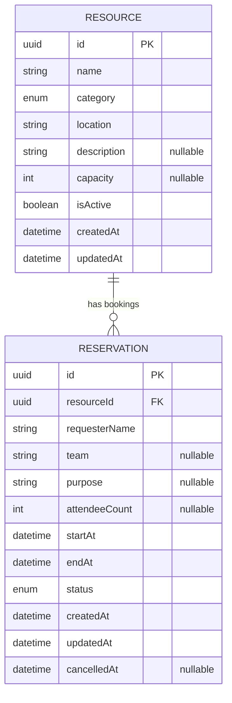

# Database Design and Reservation Integrity Architecture

**Project:** Resource Reservation Management System (RRMS)  
**Assessment:** PrimeWave Lab — Software Engineering Internship  
**Document ID:** RRMS-ARCH-001  
**Version:** 1.0 — design baseline (not implemented yet)  
**Date:** 12 October 2026  
**Intended repository path:** `docs/architecture/DATABASE_DESIGN.md`  
**Source of truth:** `docs/SRS.md` (SRS v1.0)  

> This document defines **our proposed implementation**, not a database specification supplied by PrimeWave Lab. The assessment mandates PostgreSQL, Next.js App Router, TypeScript, Git and GitHub, but leaves database details and business rules to the candidate. Refer to the SRS for scope and assumptions. Do not mark this architecture as implemented until migrations and concurrency tests pass.

## 1. Architecture decision summary

| Decision | Baseline | Why |
|---|---|---|
| Organization scope | One organization, coordinator-operated application | Matches SRS A-01/A-03; avoids unrequested authorization complexity |
| Bookable unit | One `Resource` row represents one exclusively bookable room/equipment item | Keeps conflict semantics explicit |
| Core tables | `Resource`, `Reservation` | Covers P0 without unrelated tables |
| Lifecycle | `Reservation.status` = `CONFIRMED` or `CANCELLED` | Cancelled records stay visible but do not occupy the slot |
| Temporal model | `startAt`, `endAt` as PostgreSQL `timestamptz` | Unambiguous instants; UI displays Asia/Colombo |
| Interval semantics | Half-open `[startAt, endAt)` | 10:00–11:00 and 11:00–12:00 may coexist |
| Final no-overlap authority | PostgreSQL GiST exclusion constraint, conditional on `CONFIRMED` | Prevents concurrent double-booking races |
| Resource lifecycle safety | Transactional `Resource` row lock for bookings, deactivation, and capacity changes | Prevents conflicting resource-state/booking changes |
| ORM | Prisma with SQL migration(s) for PostgreSQL-specific constraints | Typed access plus database-native integrity |
| Deletion | No hard-delete action in MVP | Preserves reservation history |

## 2. Domain model and ER diagram



**Cardinality:** One resource has zero or more reservations. Each reservation belongs to exactly one resource; the foreign key may not be null. This is a *logical* ER model. Generate a final diagram matching the actual migrations for the submission link.

### 2.1 Resource fields

| Field | PostgreSQL / model intent | Null? | Rules |
|---|---|---|---|
| `id` | UUID primary key | No | Stable identifier |
| `name` | Text | No | Trimmed and nonblank |
| `category` | Enum (`ROOM`, `EQUIPMENT`, `OTHER`) | No | Classification does **not** change exclusive-booking semantics |
| `location` | Text | No | Trimmed and nonblank |
| `description` | Text | Yes | Optional notes |
| `capacity` | Integer | Yes | Positive whole number if provided; e.g., room seats |
| `isActive` | Boolean | No | Default `true` |
| `createdAt` | `timestamptz` | No | Server/database-generated |
| `updatedAt` | `timestamptz` | No | Updated on edits |

**Uniqueness policy (BR-015):** Resources may not share the same `(trimmed case-insensitive name, trimmed case-insensitive location)` pair. Distinct locations may have identically named resources. Enforce this at PostgreSQL level using a functional unique index (or stored normalized columns), as well as user-friendly application validation.

### 2.2 Reservation fields

| Field | PostgreSQL / model intent | Null? | Rules |
|---|---|---|---|
| `id` | UUID primary key | No | Stable booking reference |
| `resourceId` | UUID foreign key → `Resource.id` | No | Restrict resource deletion |
| `requesterName` | Text | No | Nonblank and trimmed |
| `team` | Text | Yes | Optional |
| `purpose` | Text | Yes | Optional |
| `attendeeCount` | Integer | Yes | Positive when present; if capacity known, cannot exceed it |
| `startAt` | `timestamptz` | No | Must be earlier than `endAt` |
| `endAt` | `timestamptz` | No | Can be on a different calendar day |
| `status` | Enum (`CONFIRMED`, `CANCELLED`) | No | Defaults to `CONFIRMED` on create; no manual client override |
| `createdAt` | `timestamptz` | No | Audit timestamp |
| `updatedAt` | `timestamptz` | No | Changes on reschedule/cancel |
| `cancelledAt` | `timestamptz` | Yes | Set when cancelled; remains null for confirmed |

**Important:** `Upcoming`, `In progress`, and `Past` are computed using the clock and do **not** become database statuses. `CANCELLED` takes priority for display (SRS §6.3).

### 2.3 Relationship and referential integrity

- `Reservation.resourceId` references `Resource.id`, with `ON DELETE RESTRICT` (or equivalent; no hard deletion exposed).
- A resource can have many reservations *at different, non-overlapping confirmed intervals*.
- Cancelled reservations remain linked to the original resource.
- No separate `User` table: `requesterName` and optional `team` are recorded directly, per coordinator-operated P0 scope.

## 3. Invariants: what must always be true

1. For a booking: `startAt < endAt` and at creation the start must be in the future (BR-001/002).
2. Reservation points to an existing active resource at creation / rescheduling (BR-003/004).
3. **No two `CONFIRMED` reservations may overlap on the same `resourceId`** (BR-005/018).
4. Time intervals are half-open: `[startAt, endAt)`, so adjacent bookings are allowed (BR-006).
5. `CANCELLED` bookings retain history but do not occupy time (BR-008/011).
6. Only future confirmed bookings can be cancelled or rescheduled (BR-012).
7. A resource cannot be deactivated while it has a `CONFIRMED` booking whose `endAt > now` (BR-013).
8. Lowering capacity must not invalidate an ongoing/future confirmed booking's specified attendee count (BR-022).
9. All checks are enforced server-side; frontend availability is informational (BR-017/019).
10. Booking writes and state/capacity updates for a resource use the same transaction lock protocol (BR-024).

## 4. Booking overlap algorithm

For two nonempty ranges on **the same resource**, overlap means:

```text
newStart < existingEnd  AND  newEnd > existingStart
```

Examples, assuming confirmed booking **10:00–11:00** on Room A:

| Proposed Room A slot | Decision | Reason |
|---|---|---|
| 09:00–10:00 | Allowed | End meets existing start |
| 11:00–12:00 | Allowed | Start meets existing end |
| 10:00–11:00 | Rejected | Same interval |
| 10:30–11:30 | Rejected | Partial overlap |
| 09:00–12:00 | Rejected | Encloses existing interval |
| 10:15–10:45 | Rejected | Fully inside existing interval |
| Room B, 10:00–11:00 | Allowed | Different resource |
| Room A, 10:00–11:00 after original is cancelled | Allowed | Cancelled bookings do not block |

## 5. PostgreSQL constraints (schema migration design)

**These are migration examples, not commands to execute yet.** First create the Prisma schema/migration, confirm the generated table/column/enum names, then add and test the SQL. The examples assume Prisma's default quoted model names and camelCase field names.

```sql
-- Supporting operator class for UUID equality in a GiST exclusion index.
CREATE EXTENSION IF NOT EXISTS btree_gist;

-- Every reservation must occupy a positive time interval.
ALTER TABLE "Reservation"
  ADD CONSTRAINT "reservation_valid_interval"
  CHECK ("endAt" > "startAt");

-- Any two confirmed allocations for one resource must not intersect.
ALTER TABLE "Reservation"
  ADD CONSTRAINT "reservation_no_confirmed_overlap"
  EXCLUDE USING gist (
    "resourceId" WITH =,
    tstzrange("startAt", "endAt", '[)') WITH &&
  )
  WHERE ("status" = 'CONFIRMED');

-- Resource identity is unique even when names/locations have different case or edge spaces.
CREATE UNIQUE INDEX "resource_name_location_ci_unique"
  ON "Resource" (lower(btrim("name")), lower(btrim("location")));

-- Simple positive-value safeguards.
ALTER TABLE "Resource"
  ADD CONSTRAINT "resource_capacity_positive"
  CHECK ("capacity" IS NULL OR "capacity" > 0);

ALTER TABLE "Reservation"
  ADD CONSTRAINT "reservation_attendees_positive"
  CHECK ("attendeeCount" IS NULL OR "attendeeCount" > 0);
```

**Why both checks and exclusion constraints?** A `SELECT` before `INSERT` can say **free** to two simultaneous requests. The exclusion constraint is part of the atomic database write, so both conflicting confirmed rows cannot commit. PostgreSQL signals exclusion violation with SQLSTATE `23P01`; map it to a friendly conflict response, but verify how the selected Prisma version surfaces the error. The GiST exclusion constraint automatically builds the corresponding index.

**What the exclusion rule does not handle:** active/inactive resource state, capacity rules (both depend on the Resource row), operating hours (unspecified), and future P1 maintenance/blackout blocks. Those need transaction/service logic. Do not claim the exclusion rule alone solves them.

## 6. Atomic application workflows

### 6.1 Create a reservation

1. Validate the server input with Zod (valid strings/IDs/instants; `startAt < endAt`; `startAt` in the future).
2. Begin a PostgreSQL transaction.
3. Acquire a row-level `FOR UPDATE` lock on the target `Resource` row **inside that transaction**.
4. Re-read `isActive` and `capacity`. Reject nonexistent/inactive resources or attendee count above capacity.
5. Optionally read overlapping confirmed reservations to provide a helpful explanation; this **is not the final safety guarantee**.
6. Insert a `CONFIRMED` reservation. PostgreSQL's exclusion constraint makes the definitive conflict decision.
7. Commit. Report the created booking only when commit succeeds; on conflict, roll back and return a user-friendly message.

### 6.2 Reschedule a reservation (future only)

1. Within a transaction, verify the booking exists, is `CONFIRMED`, and `startAt` is still in the future.
2. Lock relevant `Resource` row(s): old and new when changing resource, in **deterministic UUID order**; recheck the reservation's current state after locking.
3. Validate target resource active state and attendee capacity; validate proposed time.
4. Update the **same reservation ID** with the new resource/time; the exclusion constraint validates the final range.
5. On error, roll back completely: the old booking remains intact.

**Implementation note:** Obtain necessary row locks consistently across all code paths; if resources are being transferred between resources, avoid deadlocks with deterministic order. Handle stale writes conservatively.

### 6.3 Cancel a reservation (future only)

1. Validate that reservation is `CONFIRMED` and has not started.
2. Within one transaction, change status to `CANCELLED` and set `cancelledAt` (do not delete the row).
3. Show confirmation; the slot is free immediately for new bookings after commit.
4. Do not allow second cancellation or reactivation in P0.

### 6.4 Deactivate a resource

1. Begin a transaction and lock the `Resource` row with `FOR UPDATE`.
2. Check for any `CONFIRMED` reservation on that resource with `endAt > now` (future or ongoing).
3. If any exists, **reject** with a message requesting that commitments be resolved first.
4. Otherwise set `isActive = false` and commit.
5. Activation changes it back to `true` (no history is lost).

### 6.5 Reduce resource capacity

1. Lock resource row inside a transaction.
2. Validate proposed capacity; query **future or ongoing confirmed** reservations (`endAt > now`) with a known `attendeeCount > newCapacity`.
3. If any exists, reject; otherwise update capacity and commit.
4. New bookings use the same resource lock, so writes cannot race past this rule.

### 6.6 Failure feedback

| Failure | User-facing result | Data result |
|---|---|---|
| Time range invalid | Explain valid start/end order | Nothing written |
| Resource inactive/not found | Explain why booking cannot proceed | Nothing written |
| Overlapping interval (`23P01`) | Slot unavailable; choose another time | Competing request at most one succeeds |
| Duplicate name/location | Resource already exists at that location | Duplicate resource not created |
| Cancellation or reschedule of ongoing/past booking | Not permitted after booking start | Original record unchanged |
| Resource deactivation with commitments | Resolve upcoming/ongoing bookings first | Active state unchanged |
| Database unavailable | Controlled error; never claim success | Transaction rolled back/no false success |

## 7. Availability and date filtering queries

- Availability is `free` only if resource exists, is active, satisfies optional capacity, and has no **confirmed** overlap for the **entire proposed interval**.
- UI preview is a **snapshot**. Revalidate as part of the actual write; trust the DB exclusion constraint.
- Day filtering uses the selected Asia/Colombo day's **start/end instants** and interval-overlap logic, not only `startAt` falling on that day. A 23:30–00:30 reservation must appear on both local days.
- For P0, a resource booking list is adequate; a complex calendar UI is P1.
- Do **not** invent opening hours, maximum durations, buffers, or holiday policies; none were defined by the assessment/SRS.

## 8. Application-layer structure (planned, not yet created)

```text
src/
  app/
    resources/                 # UI routes
    reservations/              # UI routes
  features/
    resources/
      actions.ts               # Server-side mutations
      service.ts               # Resource business policies
      validation.ts            # Zod schema
    reservations/
      actions.ts               # Server-side mutations
      service.ts               # Booking workflows and transactions
      validation.ts            # Zod schema
      availability.ts          # Read-only availability logic
  lib/
    prisma.ts                  # Singleton Prisma client / DB access
    date-time.ts               # UTC-to-Asia/Colombo display helpers
prisma/
  schema.prisma
  migrations/                  # Including raw SQL constraints
  seed.ts
```

The exact folder layout can be adjusted to the installed Next.js/Prisma versions. Business rules belong on the server, not only in UI components. No additional NestJS/Express backend or microservices are needed for this assessment.

## 9. Test/evidence plan before declaring implementation complete

| Test ID (SRS) | Scenario | Expected result |
|---|---|---|
| AT-03 | Create a valid booking | Stored as `CONFIRMED`, survives reload |
| AT-04/05 | Overlap vs touching boundary | Overlap rejected, adjacency accepted |
| AT-06 | Same times, different resources | Both accepted |
| AT-07 | Cancel then rebook same slot | Rebooking succeeds; old row stays cancelled |
| AT-09 | Failed reschedule into occupied period | Original booking unchanged |
| AT-12/13 | Deactivate with/without outstanding commitments | Reject/accept accordingly |
| AT-16 | Simultaneous conflicting creates via two clients/transactions | **Exactly one commits** |
| AT-17 | Availability preview stale before submit | Submit rejects if taken meanwhile |
| AT-20/21 | Attendee over capacity or capacity reduced below active booking | Reject |
| AT-24 | Booking versus deactivation/capacity-edit race | Database remains valid |
| AT-25 | Booking crosses midnight | Both affected local dates list it |

**Test environment:** Use a separate local/test PostgreSQL database. Do not perform destructive test resets against a shared or production database. Prefer repeatable seed and test data with cleanup.

## 10. Implementation and documentation sequence

1. Review/merge this architecture document (no database code required for the documentation issue).
2. Create a separate GitHub issue for `Prisma + PostgreSQL schema and migrations`.
3. Configure database connection and `.env.example` (never commit real credentials).
4. Implement Prisma `Resource`/`Reservation` models and run initial migration.
5. Add SQL constraints and indexes; confirm on the **actual** database.
6. Add repository/service transactions and error mapping.
7. Write database-backed integrity and concurrency tests.
8. Implement resource/reservation UI and workflows, referencing SRS acceptance IDs.
9. Publish/share the final ER diagram matching the migrated database before submitting the assessment.

## 11. Scope boundaries and traceability

| Architecture decision | SRS reference |
|---|---|
| Only Resource and Reservation for P0 | §4, §7.1 |
| UUID PK, required FK, nullable optional fields | §7.2–7.4 |
| Confirmation/cancellation lifecycle | FR-010–019; BR-008, BR-011/012 |
| Half-open booking intervals | FR-027, BR-006/007 |
| PostgreSQL exclusion constraint | FR-029, BR-005/018; §6.2 |
| Resource row locks for state/capacity races | FR-030; BR-022/024; §6.2 |
| Deactivation semantics | FR-005/006, BR-013 |
| UI timezone and overnight reservations | FR-031/037, BR-020/023 |
| P1 maintenance excluded | §4.2, FR-039/040 |

> **Deliberate limitation:** The MVP assumes a trusted local coordinator and has no authentication. It must not be publicly exposed as an unrestricted writable production system. P1 maintenance periods require an allocation model that protects booking–maintenance conflicts jointly; two independent partial exclusion rules do not suffice.
